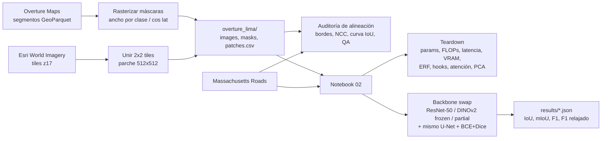

# ¿Sirven las features de DINOv2 fuera de ImageNet? Extracción de redes viales frente a CNN

**Curso:** Deep Learning · **Grupo 5** · Entrega E2 (teardown del modelo base + intervención preliminar + cuaderno de decisiones).

## Pregunta de investigación
¿Las representaciones autosupervisadas de **DINOv2** (Vision Transformer fundacional) transfieren a la extracción de redes viales en imágenes satelitales mejor que las de una **CNN (ResNet-50)** preentrenada en ImageNet, cuando se mantiene fijo el decodificador y la pérdida (*backbone swap*)?

## Definición de la tarea
- **Tarea:** segmentación semántica binaria a nivel de píxel.
- **Entrada:** parche RGB satelital de 512×512.
- **Salida:** máscara 512×512 (1 = vía/calle/carretera, 0 = fondo).
- **Cómputo:** Kaggle Notebooks con GPU T4 (16 GB), precisión mixta FP16.

## Estructura del repositorio

```
.
├── Colabs/
│   ├── 01_data_exploration_alignment.ipynb   # Datos + auditoría de alineación (Overture/Esri y Massachusetts)
│   ├── 02_teardown_backbone_swap.ipynb       # Teardown (Bloque A) + entrenamiento del backbone swap (Bloque B)
│   ├── 03_dinov2_partial_resplit.ipynb       # Massachusetts, split re-balanceado: dinov2_partial
│   ├── 04_resnet50_resplit.ipynb             # Massachusetts, split re-balanceado: resnet50
│   └── 05_dinov2_frozen_resplit.ipynb        # Massachusetts, split re-balanceado: dinov2_frozen
├── DECISIONS.md                              # Cuaderno de decisiones (Bloque C)
├── Info/                                     # Especificación del proyecto y de la E2
└── README.md
```

Los notebooks están pensados para ejecutarse en **Kaggle** (no localmente) y escriben todo bajo `/kaggle/working/`.

## Los dos datasets

| | Dataset propio (Overture + Esri) | Massachusetts Roads (referencia) |
|---|---|---|
| Etiquetas | Segmentos viales de Overture Maps (vectores), rasterizados con ancho por clase | Líneas centrales de OSM rasterizadas con ancho fijo (Mnih, 2013) |
| Imágenes | Esri World Imagery, zoom 17 (~1.17 m/px en Lima), parches de 2×2 tiles | Aéreas ~1 m/px, tiles de 1500×1500 |
| Parches | 512×512 pre-generados (`overture_lima/`) | Recortes de 512×512 al vuelo |
| Split | Bloques espaciales 70/15/15 | Original 1108/14/49 tiles; **re-balanceado 70/15/15 por tile** (820/176/175) en los notebooks 03–05 (ver D22) |
| Riesgo principal | Desalineación vector-imagen (se mide en el notebook 01) y términos de uso de Esri (por verificar) | Etiquetas con ruido de registro (también se audita) |

## Pipeline



## Cómo ejecutar en Kaggle (paso a paso)

1. **Notebook 01** (`Colabs/01_data_exploration_alignment.ipynb`)
   - Importar el notebook en Kaggle. *Settings*: **GPU T4**, **Internet: On**.
   - *Add Input*: dataset *Massachusetts Roads* (p. ej. `balraj98/massachusetts-roads-dataset`) para la Parte C.
   - Ejecutar todo. Genera `/kaggle/working/overture_lima/` (`images/`, `masks/`, `patches.csv`), `results/alignment_*.json`, `results/manual_qa.csv` y figuras.
   - *Save Version → Save & Run All*, luego en **Output → New Dataset** crear un dataset (privado) con `overture_lima/`.
2. **Notebook 02** (`Colabs/02_teardown_backbone_swap.ipynb`)
   - Importar en Kaggle con **GPU T4** e **Internet: On** (descarga DINOv2 con `torch.hub`).
   - *Add Input*: Massachusetts Roads y el dataset `overture_lima` del paso anterior.
   - **Primera corrida:** `RUN_TEARDOWN = True` (genera `results/teardown.json` y figuras) y entrenar una condición.
   - **Una versión por cada (`DATASET`, `CONDITION`)** con `RUN_TEARDOWN = False`: `massachusetts`/`overture` × `resnet50`/`dinov2_frozen`/`dinov2_partial` (6 corridas). Si hay OOM, `BATCH_SIZE = 4`.
   - Descargar los JSON de `/kaggle/working/results/` y enviarlos al equipo; opcionalmente `RUN_LABEL_AUDIT = True` con un checkpoint de Massachusetts.
3. **Notebooks 03, 04 y 05 (Massachusetts con split re-balanceado):** una condición por notebook, todos con el mismo split (`SPLIT_FRACS`, `SPLIT_SEED = 42`) y la misma semilla. No modificar esos parámetros: cambiarlos invalida la comparación entre condiciones. Cada uno escribe `results/massachusetts_<condición>_resplit.json`.
4. Completar la tabla de resultados de abajo y las conclusiones del notebook 01.

## Resultados (se completan tras las corridas en Kaggle)

Las filas de Massachusetts usan el **split re-balanceado** de los notebooks 03–05 (820/176/175 tiles; no es el test oficial de 49 tiles, ver D22), con **una sola corrida por condición** (semilla 42). Las filas de Overture (Lima) aún no se han corrido. `ms/parche` = inferencia del modelo completo, batch 8, FP16, T4 (teardown). `VRAM pico` = entrenamiento, batch 8, AMP (teardown).

| Dataset | Condición | Parámetros entrenables | IoU road | mIoU | F1 | F1 relajado (ρ=3) | ms/parche | VRAM pico (MB) |
|---|---|---|---|---|---|---|---|---|
| Massachusetts | resnet50 | 28.00 M | 0.6261 | 0.8005 | 0.7700 | 0.9108 | 10.2 | 2980 |
| Massachusetts | dinov2_frozen | 3.47 M | 0.5760 | 0.7733 | 0.7309 | 0.8965 | 15.2 | 1303 |
| Massachusetts | dinov2_partial | 7.02 M | 0.5809 | 0.7758 | 0.7349 | 0.8997 | 15.2 | 1706 |
| Overture (Lima) | resnet50 | _pendiente_ | _pendiente_ | _pendiente_ | _pendiente_ | _pendiente_ | _pendiente_ | _pendiente_ |
| Overture (Lima) | dinov2_frozen | _pendiente_ | _pendiente_ | _pendiente_ | _pendiente_ | _pendiente_ | _pendiente_ | _pendiente_ |
| Overture (Lima) | dinov2_partial | _pendiente_ | _pendiente_ | _pendiente_ | _pendiente_ | _pendiente_ | _pendiente_ | _pendiente_ |

### Resultados de entrenamiento en Massachusetts (split re-balanceado)

Corridas de `Colabs/03`, `04` y `05` (carpeta `Colabs/teardown - primeros resultados/`) en Kaggle T4, AMP FP16, 20 épocas, batch 8, mismo decodificador (3.10 M), misma pérdida (BCE + Dice) y misma semilla. Datos: 2460 / 1363 / 1339 recortes de 512×512 (train / val / test) sobre 820 / 176 / 175 tiles.

**Test (mejor checkpoint por `IoU_road` de validación):**

| Condición | Mejor época | IoU road | IoU fondo | mIoU | F1 | Precisión | Recall | F1 relajado (ρ=3) |
|---|---|---|---|---|---|---|---|---|
| resnet50 | 20 | **0.6261** | 0.9750 | 0.8005 | 0.7700 | 0.7772 | 0.7630 | **0.9108** |
| dinov2_partial | 19 | 0.5809 | 0.9707 | 0.7758 | 0.7349 | 0.7293 | 0.7406 | 0.8997 |
| dinov2_frozen | 20 | 0.5760 | 0.9706 | 0.7733 | 0.7309 | 0.7325 | 0.7294 | 0.8965 |

**Validación (última época):** resnet50 IoU road 0.6384 · dinov2_partial 0.5926 · dinov2_frozen 0.5883.

**Costo:**

| Condición | Parámetros totales | Entrenables | GFLOPs (forward, 512²) | ms/parche (b8, FP16) | VRAM entrenamiento b8 AMP | Tiempo por época |
|---|---|---|---|---|---|---|
| resnet50 | 28.00 M | 28.00 M | 59.4 | 10.2 | 2980 MB | ≈ 100 s |
| dinov2_frozen | 25.53 M | 3.47 M | 109.4 | 15.2 | 1303 MB | ≈ 105 s |
| dinov2_partial | 25.53 M | 7.02 M | 109.4 | 15.2 | 1706 MB | ≈ 105–118 s |

Lectura:
- **ResNet-50 gana en todas las métricas de test.** Supera a `dinov2_partial` por 4.5 puntos de `IoU_road` y a `dinov2_frozen` por 5.0. Los DINOv2 convergen más despacio (la validación de ResNet-50 llega a 0.61 en la época 5; la de DINOv2 llega a 0.55–0.56).
- **Descongelar los últimos 2 bloques ayuda poco:** `dinov2_partial` mejora a `dinov2_frozen` en 0.5 puntos de IoU road, 0.4 de F1 y 0.3 de F1 relajado. Con una sola corrida por condición no se puede afirmar que esa diferencia sea real y no ruido de semilla.
- **Con la métrica relajada la brecha casi desaparece:** entre ResNet-50 y `dinov2_frozen` hay 5.0 puntos de IoU road pero solo 1.4 de F1 relajado (0.911 vs 0.897). Es compatible con que DINOv2 localiza las vías con unos pocos píxeles de error (tokens de 14 px), pero esto no se ha puesto a prueba directamente.
- **Precisión y recall:** ResNet-50 está equilibrado (0.777 / 0.763); `dinov2_partial` tiene algo más de recall que de precisión (0.741 / 0.729).
- **Eficiencia:** DINOv2 cuesta 1.8× más FLOPs y 1.5× más latencia que ResNet-50, pero entrena con menos VRAM (1.3–1.7 GB frente a 3.0 GB) y con 2–8× menos parámetros entrenables.
- **Generalización:** el test queda 1.1–1.2 puntos de IoU por debajo de la validación en las tres condiciones. No hay señal de sobreajuste.
- **Primera época:** tardó 1665 s (`dinov2_frozen`), 632 s (`dinov2_partial`) y ≈ 100 s (ResNet-50), frente a ≈ 105 s las siguientes. Probablemente sea la lectura inicial de los tiles y la compilación de kernels, pero no se verificó la causa; esos tiempos no son representativos del entrenamiento.
- **Comparabilidad:** `mIoU` aquí promedia `IoU_road` e `IoU_bg`, por lo que no es comparable con el 59–63 % de la literatura; además el split no es el oficial (D22).

### Teardown (Bloque A, notebook 02)

| Condición | Parámetros totales | Entrenables | GFLOPs | ms/parche (b1, FP16) | ms/parche (b8, FP16) |
|---|---|---|---|---|---|
| resnet50 | 28.00 M | 28.00 M | 59.38 | 10.03 | 10.23 |
| dinov2_frozen / partial | 25.53 M | 3.47 M / 7.02 M | 109.43 | 15.34 | 15.22 |

- El decodificador es idéntico en las tres condiciones (3 098 433 parámetros, verificado con `assert`).
- En DINOv2 casi todo el costo está en el backbone (93.4 de 109.4 GFLOPs): 12 bloques de 7.73 GFLOPs cada uno. El FLOP medido de un bloque ViT coincide con el analítico (3.866 GMACs, diferencia 0.0 %).
- En FP32 la brecha de latencia es mayor (≈ 45 ms vs ≈ 21–26 ms por parche); FP16 reduce ambos a 10–15 ms.
- Pendiente: el campo receptivo efectivo, los mapas de activación de ResNet-50 y de atención de DINOv2 y el PCA de tokens no están incluidos aquí, porque esas celdas de la corrida entregada fallaron por falta del dataset.

**Alineación Overture vs Massachusetts** (de `results/alignment_*.json`): _pendiente_ (mediana de |offset| en px y m, % ≤ 2 px, fracción media de vía, IoU a 2 y 4 px).

Nota: `mIoU` se define aquí como el promedio de `IoU_road` e `IoU_bg`; compárese con la literatura solo si usa la misma definición.

## Decisiones, hipótesis y licencias
Ver [DECISIONS.md](DECISIONS.md): decisiones de datos, arquitectura y cómputo, hipótesis pre-registradas (H1–H4), licencias (Esri y Overture **por verificar**), uso responsable y declaración de asistencia de IA.

**Atribución de imágenes:** *Source: Esri, Maxar, Earthstar Geographics, and the GIS User Community.* El equipo debe verificar los términos de uso de Esri antes de redistribuir imágenes o publicar el dataset.

## Referencias
- Oquab, M. et al. (2023). *DINOv2: Learning Robust Visual Features without Supervision.* arXiv:2304.07193.
- He, K., Zhang, X., Ren, S., Sun, J. (2016). *Deep Residual Learning for Image Recognition.* CVPR.
- Ronneberger, O., Fischer, P., Brox, T. (2015). *U-Net: Convolutional Networks for Biomedical Image Segmentation.* MICCAI.
- Mnih, V. (2013). *Machine Learning for Aerial Image Labeling.* PhD thesis, University of Toronto. (Massachusetts Roads.)
- Mnih, V., Hinton, G. (2010). *Learning to Detect Roads in High-Resolution Aerial Images.* ECCV. (Métrica relajada.)
- Luo, W., Li, Y., Urtasun, R., Zemel, R. (2016). *Understanding the Effective Receptive Field in Deep Convolutional Neural Networks.* NeurIPS.
- Overture Maps Foundation. Cómo obtener los datos: <https://docs.overturemaps.org/getting-data/>
- Meta AI for Good. Transportation Networks: <https://ai.meta.com/ai-for-good/datasets/transportation-networks/>
