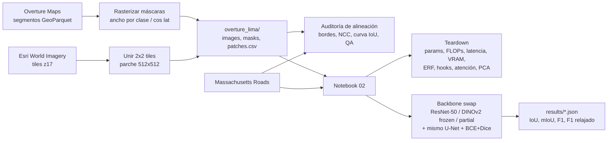

# ¿Sirven las features de DINOv2 fuera de ImageNet? Extracción de redes viales frente a CNN

**Curso:** Deep Learning · **Grupo 5** · Entrega E2 (teardown del modelo base + intervención preliminar + cuaderno de decisiones).

## Pregunta de investigación
¿Las representaciones autosupervisadas de **DINOv2** (Vision Transformer fundacional) transfieren a la extracción de redes viales en imágenes satelitales mejor que las de una **CNN (ResNet-50)** preentrenada en ImageNet, cuando se mantiene fijo el decodificador y la pérdida (*backbone swap*)?

## Definición de la tarea
- **Tarea:** segmentación semántica binaria a nivel de píxel.
- **Entrada:** parche RGB satelital de 512×512.
- **Salida:** máscara 512×512 (1 = vía/calle/carretera, 0 = fondo).
- **Cómputo:** Kaggle Notebooks con GPU T4 (16 GB), precisión mixta FP16.

## Estructura del repositorio

```
.
├── Colabs/
│   ├── 01_data_exploration_alignment.ipynb   # Datos + auditoría de alineación (Overture/Esri y Massachusetts)
│   ├── 02_teardown_backbone_swap.ipynb       # Teardown (Bloque A) + entrenamiento del backbone swap (Bloque B)
│   ├── 03_dinov2_partial_resplit.ipynb       # Massachusetts, split re-balanceado: dinov2_partial
│   ├── 04_resnet50_resplit.ipynb             # Massachusetts, split re-balanceado: resnet50
│   └── 05_dinov2_frozen_resplit.ipynb        # Massachusetts, split re-balanceado: dinov2_frozen
├── DECISIONS.md                              # Cuaderno de decisiones (Bloque C)
├── Info/                                     # Especificación del proyecto y de la E2
└── README.md
```

Los notebooks están pensados para ejecutarse en **Kaggle** (no localmente) y escriben todo bajo `/kaggle/working/`.

## Los dos datasets

| | Dataset propio (Overture + Esri) | Massachusetts Roads (referencia) |
|---|---|---|
| Etiquetas | Segmentos viales de Overture Maps (vectores), rasterizados con ancho por clase | Líneas centrales de OSM rasterizadas con ancho fijo (Mnih, 2013) |
| Imágenes | Esri World Imagery, zoom 17 (~1.17 m/px en Lima), parches de 2×2 tiles | Aéreas ~1 m/px, tiles de 1500×1500 |
| Parches | 512×512 pre-generados (`overture_lima/`) | Recortes de 512×512 al vuelo |
| Split | Bloques espaciales 70/15/15 | Original 1108/14/49 tiles; **re-balanceado 70/15/15 por tile** (820/176/175) en los notebooks 03–05 (ver D22) |
| Riesgo principal | Desalineación vector-imagen (se mide en el notebook 01) y términos de uso de Esri (por verificar) | Etiquetas con ruido de registro (también se audita) |

## Pipeline



## Cómo ejecutar en Kaggle (paso a paso)

1. **Notebook 01** (`Colabs/01_data_exploration_alignment.ipynb`)
   - Importar el notebook en Kaggle. *Settings*: **GPU T4**, **Internet: On**.
   - *Add Input*: dataset *Massachusetts Roads* (p. ej. `balraj98/massachusetts-roads-dataset`) para la Parte C.
   - Ejecutar todo. Genera `/kaggle/working/overture_lima/` (`images/`, `masks/`, `patches.csv`), `results/alignment_*.json`, `results/manual_qa.csv` y figuras.
   - *Save Version → Save & Run All*, luego en **Output → New Dataset** crear un dataset (privado) con `overture_lima/`.
2. **Notebook 02** (`Colabs/02_teardown_backbone_swap.ipynb`)
   - Importar en Kaggle con **GPU T4** e **Internet: On** (descarga DINOv2 con `torch.hub`).
   - *Add Input*: Massachusetts Roads y el dataset `overture_lima` del paso anterior.
   - **Primera corrida:** `RUN_TEARDOWN = True` (genera `results/teardown.json` y figuras) y entrenar una condición.
   - **Una versión por cada (`DATASET`, `CONDITION`)** con `RUN_TEARDOWN = False`: `massachusetts`/`overture` × `resnet50`/`dinov2_frozen`/`dinov2_partial` (6 corridas). Si hay OOM, `BATCH_SIZE = 4`.
   - Descargar los JSON de `/kaggle/working/results/` y enviarlos al equipo; opcionalmente `RUN_LABEL_AUDIT = True` con un checkpoint de Massachusetts.
3. **Notebooks 03, 04 y 05 (Massachusetts con split re-balanceado):** una condición por notebook, todos con el mismo split (`SPLIT_FRACS`, `SPLIT_SEED = 42`) y la misma semilla. No modificar esos parámetros: cambiarlos invalida la comparación entre condiciones. Cada uno escribe `results/massachusetts_<condición>_resplit.json`.
4. Completar la tabla de resultados de abajo y las conclusiones del notebook 01.

## Resultados (se completan tras las corridas en Kaggle)

Las filas de Massachusetts usan el **split re-balanceado** de los notebooks 03–05 (820/176/175 tiles; no es el test oficial de 49 tiles, ver D22). Las filas con `_pendiente_` aún no se han corrido.

| Dataset | Condición | Parámetros entrenables | IoU road | mIoU | F1 | F1 relajado (ρ=3) | ms/parche | VRAM pico (MB) |
|---|---|---|---|---|---|---|---|---|
| Massachusetts | resnet50 | 28.00 M | 0.6261 | 0.8005 | 0.7700 | 0.9108 | _pendiente_ (teardown) | _pendiente_ |
| Massachusetts | dinov2_frozen | _pendiente_ | _pendiente_ | _pendiente_ | _pendiente_ | _pendiente_ | _pendiente_ | _pendiente_ |
| Massachusetts | dinov2_partial | _pendiente_ | _pendiente_ | _pendiente_ | _pendiente_ | _pendiente_ | _pendiente_ | _pendiente_ |
| Overture (Lima) | resnet50 | _pendiente_ | _pendiente_ | _pendiente_ | _pendiente_ | _pendiente_ | _pendiente_ | _pendiente_ |
| Overture (Lima) | dinov2_frozen | _pendiente_ | _pendiente_ | _pendiente_ | _pendiente_ | _pendiente_ | _pendiente_ | _pendiente_ |
| Overture (Lima) | dinov2_partial | _pendiente_ | _pendiente_ | _pendiente_ | _pendiente_ | _pendiente_ | _pendiente_ | _pendiente_ |

### Resultado preliminar: ResNet-50 en Massachusetts (split re-balanceado)

Corrida de `Colabs/04_resnet50_resplit.ipynb` en Kaggle (T4, AMP FP16, 20 épocas, ~100 s/época, ≈ 34 min en total). Datos: 2460 / 1363 / 1339 recortes de 512×512 (train / val / test) sobre 820 / 176 / 175 tiles.

| Conjunto | IoU road | mIoU | F1 | Precisión | Recall | F1 relajado (ρ=3) |
|---|---|---|---|---|---|---|
| Validación (época 20) | 0.6384 | 0.8090 | 0.7793 | – | – | 0.9159 |
| **Test** (mejor checkpoint, época 20) | **0.6261** | 0.8005 | 0.7700 | 0.7772 | 0.7630 | 0.9108 |

Lectura:
- **Convergencia:** la `IoU_road` de validación sube de 0.457 (época 1) a 0.614 (época 5) y se estabiliza en 0.638 desde la época ~17; no hay señal de sobreajuste (la pérdida de validación baja de forma sostenida hasta ≈ 0.357).
- **Generalización:** el test queda ≈ 1.2 puntos de IoU por debajo de la validación (0.626 vs 0.638), una brecha pequeña con un test de 175 tiles.
- **Error de posición:** `F1` estricto 0.770 frente a `F1` relajado 0.911. Gran parte de los errores son desplazamientos de pocos píxeles, consistente con el ruido de registro de las etiquetas (OSM rasterizado).
- **Precisión y recall equilibrados** (0.777 / 0.763): el modelo no está sesgado hacia sobre- ni subsegmentar.
- **Comparabilidad:** `mIoU` aquí es el promedio de `IoU_road` e `IoU_bg` (0.975), por lo que su valor alto **no es comparable** con el mIoU de la literatura (59–63 %). Además, el split no es el oficial. Es el punto de referencia para `dinov2_frozen` y `dinov2_partial` con el mismo split.
- Pendiente: tiempo por parche y VRAM pico (salen del teardown y del JSON de la corrida).

**Alineación Overture vs Massachusetts** (de `results/alignment_*.json`): _pendiente_ (mediana de |offset| en px y m, % ≤ 2 px, fracción media de vía, IoU a 2 y 4 px).

Nota: `mIoU` se define aquí como el promedio de `IoU_road` e `IoU_bg`; compárese con la literatura solo si usa la misma definición.

## Decisiones, hipótesis y licencias
Ver [DECISIONS.md](DECISIONS.md): decisiones de datos, arquitectura y cómputo, hipótesis pre-registradas (H1–H4), licencias (Esri y Overture **por verificar**), uso responsable y declaración de asistencia de IA.

**Atribución de imágenes:** *Source: Esri, Maxar, Earthstar Geographics, and the GIS User Community.* El equipo debe verificar los términos de uso de Esri antes de redistribuir imágenes o publicar el dataset.

## Referencias
- Oquab, M. et al. (2023). *DINOv2: Learning Robust Visual Features without Supervision.* arXiv:2304.07193.
- He, K., Zhang, X., Ren, S., Sun, J. (2016). *Deep Residual Learning for Image Recognition.* CVPR.
- Ronneberger, O., Fischer, P., Brox, T. (2015). *U-Net: Convolutional Networks for Biomedical Image Segmentation.* MICCAI.
- Mnih, V. (2013). *Machine Learning for Aerial Image Labeling.* PhD thesis, University of Toronto. (Massachusetts Roads.)
- Mnih, V., Hinton, G. (2010). *Learning to Detect Roads in High-Resolution Aerial Images.* ECCV. (Métrica relajada.)
- Luo, W., Li, Y., Urtasun, R., Zemel, R. (2016). *Understanding the Effective Receptive Field in Deep Convolutional Neural Networks.* NeurIPS.
- Overture Maps Foundation. Cómo obtener los datos: <https://docs.overturemaps.org/getting-data/>
- Meta AI for Good. Transportation Networks: <https://ai.meta.com/ai-for-good/datasets/transportation-networks/>
